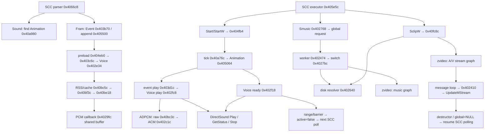

# Original Audio Runtime — Agent: Особое задание (2001)

Дата исследования: 18 октября 2026. **Исследование, не реализация.** `src/`, чужие изменения и исходные игровые файлы не изменялись; игра и browser E2E не запускались.

## 1. Результат и границы доказательств

**CONFIRMED (static):** звук действительно может задерживать SCC **косвенно через анимацию**. `StartW` опрашивает `Animation+0xbb9`, а кадровый WAV с положительным конечным кадром удерживает диапазон анимации до снятия `DSBSTATUS_PLAYING`. Это не ожидание всех звуков сцены. Эффекты с `endFrame=0` такого барьера не создают. `Sound` — загрузочная директива привязки событий, а не исполняемая команда воспроизведения. Музыка — отдельный глобальный MP3/DirectShow-тракт, не один из 835 WAV.

**CONFIRMED (static)** означает ресурсные байты либо инструкции/связанный data flow исследованных бинарников, **не наблюдение запущенного Windows-процесса**. **DERIVED** — явно обозначенное следствие этих фактов. **UNKNOWN** — незамкнутый путь или поведение, требующее динамической проверки. Имена структур и событий backend ниже введены исследователем, не являются исходными символами игры.

Прочитаны [SCC_RUNTIME.md](../scc/SCC_RUNTIME.md), [SCC_VISIBILITY_INIT.md](../scc/SCC_VISIBILITY_INIT.md), [IMPLEMENTATION_STATUS.md](../../docs/IMPLEMENTATION_STATUS.md), дополнительно [MULT_FORMAT.md](../mult/MULT_FORMAT.md). Прежние минимальные рекомендации «Smusic — no-op» и «SclipW — один yield» — допустимые заглушки прежнего среза, **не оригинальная семантика**. Утверждение текущего порта, что звуки `K_pistol`/`Razres`/`K_nar` не являются барьерами, оригиналу не соответствует: соответствующие SCC содержат положительные `endFrame`.

### Бинарники и воспроизводимость

Оригиналы доступны в основном checkout, не скопированы в этот worktree:

```text
/Users/le30r/repos/agent-revers/agent-original/
  game-installed/Program_Executable_Files/Agent.exe
  game-installed/Program_Executable_Files/zvideo.dll
  game-installed/Program_Executable_Files/Scripts/*
  game-resources/block*/...
```

| Объект | Идентичность |
|---|---|
| `Agent.exe`, PE32/x86, base `0x00400000` | SHA-256 `71065c571a9cd40f460458d766720c0a01954e0bef521aad675b4ea6b3186e85` |
| `zvideo.dll`, PE32/x86, base `0x10000000` | SHA-256 `d6c1ae4457ef17357ff5da36391ac39567aee861d6ea44483df8b711c656f3b6` |
| REA / Ghidra | `6.4.0` / `12.1.4`; REA MCP через локальный stdio-клиент |
| Профиль EXE | `4f6212bfe31448a7b96743a449e91c35890105cedd34e1d9951e9467d284e0a5` |
| Профиль DLL | `6140685e5b2aef0801e1b3678e4af523eb266d71cc53a4aca16fd4ab39a02890` |

Все адреса ниже — **VA соответствующего модуля**, не файловые offsets. Запрашивались адресные `procedure_pseudo_code`, `procedure_assembly`, `analyze_function`, `xrefs`; полный EXE не декомпилировался. Для WAV callback `0x4029fc`, который Ghidra не выделил как функцию, дополнительно прочитаны инструкции `objdump` в диапазоне `0x4029fc..0x402c04`. Отсутствие Ghidra-function здесь не означает отсутствие кода.

Сырые ответы и REA evidence bundle сохранены **вне Git**, в `/private/tmp/agent-audio-evidence/`: `agent-bundle.json`, `agent-supplemental-bundle.json`, `zvideo-bundle.json`; это временные локальные артефакты, не переносимые ссылки репозитория. Для повторения: открыть точный бинарник через REA `open_binary(provider_id="ghidra")`, запросить перечисленные адреса, сверить инструкции, а для DLL открыть отдельный target. Не доверять одним псевдосигнатурам: у COM и cdecl DLL-вызовов Ghidra теряет аргументы и иногда неверно восстанавливает return value.

Опорные Evidence ID, достаточные для поиска в локальных bundle:

| Доказательство | Evidence ID |
|---|---|
| `0x405064`, animation update | `ev_f78fda1cef267dde98dc0608600554da3bb7ebce7f41e2ef18a6fda7946e70c2` |
| `0x402f18`, dossier проверки WAV | `ev_9dd4d64a03493e7ee68045e47a2dba6f1319204a51c6ef568f8907a40a842fa6` |
| `0x402fc8`, dossier play/replay | `ev_8b33a1da935af824c4830a7be58df74a0c5b3d258b7f2145a8b47b760b6fc5d2` |
| `0x403d1c`, dossier категории/громкости | `ev_a5ee7dd9f23cd0d663b79f71034d4c399b972d26298e1e44ab1319a0b16c9ed2` |
| `0x404ff4`, dossier прерывания | `ev_f210004da005c8b3a36c80ae29230e6f1925f2ceec3e76c288976b2ba2227615` |
| `0x402474`, dossier music worker | `ev_6d04989f5f59f9e2f5514450b354fdfa98029aaa4d93cdd5d99ac7457762a7e2` |
| `0x40fc8c`, dossier открытия AVI | `ev_9926d0ecc9588b689fdc11af95c2acb3ce043cd5bb89932f6ec791b0466aa95c` |
| `0x402410`, dossier video update | `ev_cc51ee36d211317708487d368e97f03ae633dc15faea72edb871107653126500` |
| DLL `0x10001290`, dossier video init | `ev_018c1751ed36bbe6913ec4fb840c95c4f72c8950e58df4f90a7e4c4b7f66f47b` |
| DLL `0x100013e0`, dossier video update | `ev_be03c6da247f761537e99ace238250d4f7e4761f33ea775c578b40e995704aad` |

## 2. Ресурсы: категории, ссылки, разрешение имён

### 2.1. Корпус — CONFIRMED (resource inspection)

В 57 SCC обнаружены 507 `Sound`, 1419 `Fram`, 143 `Fault`, 50 `Smusic`, 5 `SclipW`. У `Fram` 808 записей с `endFrame=0`, 452 с положительным концом, 159 с `-1`. Это подсчёт исходных строк, не гарантия успешного разбора каждой строки оригинальным scanf.

В извлечённом `game-resources` **835 WAV**. Форматы RIFF `fmt.wFormatTag`: **803 Microsoft ADPCM (`2`)**, **1 IMA ADPCM (`17`)**, **31 PCM (`1`, 16-bit)**. Есть mono/stereo, частоты 11025/22050/44100. Расширение `.wav` не означает несжатый PCM. Ни одного MP3 в этом извлечённом дереве не обнаружено; это не доказательство отсутствия музыки на исходных CD.

Лексическая выборка WAV-токенов из хвостов `Fram`/`Fault` дала 1412 упоминаний, 653 уникальных case-insensitive пути; все они разрешаются в извлечённом дереве после удаления внешнего `blockN/` и нормализации slash/case. Это **сверхмножество реально разобранных ссылок**: лишние токены повреждённых строк тоже попадают в выборку. Остальные 182 WAV нельзя объявлять неиспользуемыми: есть UI/движковые потребители вне этих директив.

Для идентификации SCC-корпуса: SHA-256 последовательной конкатенации `filename UTF-8 + NUL + SHA256(file).digest()` по 57 файлам в сортировке имён — `def62f9d12ec693378a71be31575c8d6f4f81e170cde867f56748b5b00180018`.

### 2.2. WAV — ресурсное имя, не относительный путь к SCC

Примеры `Scripts/Level1.scc`:

```text
Sound Takedr1
  Fram 1 1 1 Mainhero sound\scn_01\konst\004.wav
  Fram 32 0 1 Mainhero sound\scn_01\Eff\002.wav
Fault Morda 1 SOUND\scn_01\otboy\otd_001.wav
```

`Sound Takedr1` выбирает уже объявленную анимацию. WAV-имя хранится в её SCC-событии `Fram`, **не в бинарном MULT**. MULT даёт изображения/объекты и нумерацию кадров; аудиохуки добавляются SCC поверх кадрового cursor той же анимации. `scn_01` звука и `SCN_37` MULT в Level1 не обязаны совпадать.

Цепочка разрешения:

```text
Fram.path → Event+0x50c → Voice+0x42
  → 0x40bc5c(resourceManager, name, 1)
    → extension dispatch → 0x40bf3c → 0x40bbcc
      → bsearch по RSS directory entries (stride 0x5c)
        comparator 0x40af40 → 0x435404 (case-insensitive)
      → 0x40be18: cached object либо чтение RSS/callback
```

`block0`…`block9` — внешние контейнеры извлечения, не часть SCC-ключа. Оригинальный lookup сравнивает полное ресурсное имя без учёта регистра; это не поиск по одному basename и не автоподстановка каталога сцены. Преобразование `/`↔`\` в оригинальном сравнителе не обнаружено: в web-индексе его следует делать как адаптацию путей, не выдавать за восстановленный алгоритм EXE. Не путать третий stack-аргумент `1` с cache scope: тег загруженного элемента записывает `0x40be18` из текущего `*ResourceManager` в `+0x6204+index*4`.

`0x40bc5c` выбирает WAV callback по слабому extension discriminator `extension[1] + 2*extension[3] == 0x103` после lower-case extension. Не следует копировать эту коллизионную проверку в безопасный загрузчик. Отсутствующий ресурс идёт через `0x40bf3c` к предупреждению `Missing resource: %s\nInterrupt execution?`, а не к доказанному безусловному silent-success.

### 2.3. Какие категории действительно существуют

| Категория | Что установлено | Уверенность |
|---|---|---|
| Кадровые эффекты/окружение | `Fram.end=0`, регистр громкости `0x46873e`; могут иметь `Repeat` | CONFIRMED |
| Кадровый синхронизированный звук | `Fram.end>0`, регистр `0x46873a`; диапазон анимации удерживается до конца звука | CONFIRMED |
| Реплики `Fault` | Список WAV по объекту, выбор одного варианта, подстановка в общий `Speak` с диапазоном `1..3` | CONFIRMED |
| Музыка | `Smusic <loop-int> <filename.mp3>`; глобальный manager `*(0x461680)`, отдельный worker и DirectShow graph | CONFIRMED |
| Звук AVI | Audio stream внутри graph `zvideo.dll`; не SCC `Fram` и не WAV resource voice | CONFIRMED |
| Каталоги `konst`, `otboy`, имена персонажей, `Eff`, `Global`, `Interface` | Контентные группы; контекст `Speak`/`Fault` указывает на речь, `Eff`/шаги — на эффекты | DERIVED, без прослушивания |

Код выбирает WAV-громкость **по `endFrame`, не по имени каталога**. Поэтому «speech» и «effects» — полезные названия двух control-bus, но нельзя классифицировать их только по `.wav` или по `konst/`. `Global` в пути **не означает** межсценовую продолжительность. Поддержка субтитров (`Sound\subtitres.sub`, global `0x46875c`, enable byte `0x468739`) также отделена от PCM-буфера: play уведомляет `0x40b398(name)`, конец/stop — `0x40b3e4(name)`.

## 3. Таблица оригинальных SCC-команд

Общий parser `0x4066c8`, token hash `0x4058d8`; executor `0x405e5c`, dispatch `0x405ea1`. Ниже адрес ветки указан отдельно от адреса вызываемого helper. Для загрузочных директив runtime opcode отсутствует.

| Операция / аргументы | Parser: hash; ветка | Runtime dispatch / handler | Записи и наблюдаемая семантика | Уверенность |
|---|---|---|---|---|
| `Sound <animation>` | `0x174f8`; `0x406f9e` | Нет opcode; `0x40a980(scene,name)` | Выбирает текущую Animation для последующих `Fram`; не играет звук, не блокирует Program | CONFIRMED |
| `Fram <start:int> <end:int> <N:int> <object1>…<objectN> <wav-or-value>` | `0x1422f`; `0x406fcb..0x4070e3` | Загрузка `0x403b70`, `0x403c34`, `0x405500`; выполнение `0x405064` → `0x403d1c` | Создаёт Event `0x612` bytes; записывает start/end/count/object names/path; прикрепляет к Animation. `N` — число затрагиваемых **объектов**, не канал/приоритет и не число WAV | CONFIRMED |
| `Repeat` | `0x16d5e`; `0x4070e8` | Play `0x403d1c` → `0x402fc8` | `lastEvent+0x60d=1`; preload копирует в `Voice+1`; `Play` получает looping flag `1`. Не отдельная Program-инструкция | CONFIRMED |
| `Fault <object> <N:int> <wav1>…<wavN>` | `0x13cc6`; `0x4078a0..0x40795f` | `0x40ab4c`, `0x40ac00`; выбор `0x40ac64`; click helper `0x408350` | Создаёт именованный список Voice; выбирает один вариант и подставляет в синтетический `Speak`-event; дальнейшее ожидание через `StartW Speak` | CONFIRMED |
| `Start <animation>` | `0x17638`; `0x4073d3` | opcode `0`; `0x4061a0` → `0x40a980` → `0x404fb4(anim,1)` | timer=0, frame=1, barrier=null, active=1; Program продолжает синхронно | CONFIRMED |
| `StartW <animation>` | `0x1768f`; `0x4073a3` | opcode `1`; `0x405f7c` → `0x404fb4` | Сохраняет pc, ставит waiting и scene busy; yield. На повторном входе ждёт `anim+0xbb9==0`; не опрашивает global audio | CONFIRMED |
| `Stop <animation>` | `0x1764e`; `0x407403` | opcode `0x15`; `0x4061d5` → `0x404fb4(anim,0)` → `0x404ff4(anim,1)` | Сброс timer/frame/barrier, попытка stop первого latched Event, active=0; немедленно продолжает Program. **Не** «остановить всю музыку/все звуки» | CONFIRMED |
| `Smusic <A:int> <filename>` | `0x1749d`; `0x407794` | opcode `0x17`; `0x40645f` → `0x402768(manager,name,A>0)` | При отличающемся case-insensitive имени: name, requestedLoop, pending=1. Тот же трек — no-op, даже при другом loop-аргументе. Program не ждёт загрузки/музыки | CONFIRMED |
| `SclipW <A:int> <filename>` | `0x1704c`; `0x407810` | opcode `0x1b`; `0x405f2d` → `0x40fc8c` | A сохраняется в instruction, но в этой runtime-ветке **не читается**. Глобальный video gate, pc и yield; ожидание null video pointer | CONFIRMED |

В 50 `Smusic` в корпусе A всегда `1`; всего 13 различных имён, включая `empty.mp3`. `A=0` в коде означает **не loop**, а не команду StopMusic. Для `empty.mp3` специальной ветки не найдено: это имя ресурса, не доказанная команда тишины. Отдельная SCC-команда «ждать WAV» или StopMusic в исследованном корпусе и исполнительных ветках не обнаружена. Не присваивать предполагаемые имена неиспользуемым opcode `0x18/0x19`: parser такие записи способен создать, но sound-handler для них в данном executor не установлен.

### Особенности исходного текста

`Fram.end=-1` — переключение depth указанного объекта через `atoi(value)` и `Object+0x108`, **не звук**. `Fram.end=0` — неблокирующий effect. `Fram.end>0` — sync-range, а не длительность в миллисекундах.

`N=1` у 1418 исходных строк; одна строка `Level8.scc:130` — `Fram 44 46 Mainhero ...005.wav`, без N. Есть 4 строки с дополнительным WAV после уже завершённого `Fram` и 8 с корректным `Repeat`. Парсер token/scanf-based, не line-based; лишний WAV **не превращается** в случайный вариант звука. Ошибочную строку нельзя автоматически «починить» и назвать это оригинальной семантикой; точный результат failed scanf здесь UNKNOWN.

## 4. Структуры, поля и адреса

Все offsets — **байтовые**, структуры packed. Не выводить их из индексов `int*` Ghidra без пересчёта.

| Структура / global | Поле | Значение / writers |
|---|---|---|
| Program | `+0x29e4`, `+0x29e5`, `+0x29e6`, `+0x29e7` | active byte, waiting byte, execution mode byte, saved pc int; `0x405d30`/`0x405e5c` |
| Program instruction (`0x10c` bytes) | `+0`, `+4`, `+8`, `+0xc` | opcode, A, B, string[256]; массив начинается Program+4 |
| Scene | `+0x709` | input-busy `StartW`; не sound-manager mutex |
| Scene | `+0xd`, `+0x11` | animation count, указатели Animation |
| Scene | `+0x639`, `+0x63d` | число/массив Fault-списков |
| Scene | `+0x741` | guard освобождения в `0x407c14`; ниже описан обычный случай `==0` |
| Animation (`0xbba` bytes) | `+0x000`, `+0x100` | имя, MULT resource name |
| Animation | `+0x200`, `+0x201`, `+0x205` | loop byte, loaded MULT pointer, frame count |
| Animation | `+0x209`, `+0x20d` | interval `1000/rate`, последний tick-time |
| Animation | `+0x211`, `+0x311` | completion SCC event name; 1-based frame cursor |
| Animation | `+0xae5`, `+0xae9` | event count; массив event pointers (до `+0xbb0`, 50 слотов) |
| Animation | `+0xbb1`, `+0xbb8`, `+0xbb9` | текущий sync Event pointer; apply-all/first-pass byte; active byte |
| FrameEvent (`0x612` bytes) | `+0`, `+4`, `+8` | startFrame, endFrame, object count; `0x403b70` |
| FrameEvent | `+0x00c` | пять slots object-name[256]; `N` управляет заполнением/сравнением |
| FrameEvent | `+0x50c` | WAV resource path[256] либо числовая строка depth |
| FrameEvent | `+0x60c`, `+0x60d`, `+0x60e` | latched/started byte; Repeat byte; Voice pointer; `0x403c6c`/`0x403d1c`/`0x405064` |
| Voice (`0x92` bytes) | `+0` | deferred/private flag: первоначальная загрузка не дала shared PCM buffer |
| Voice | `+1`, `+2` | repeat byte; deferred volume int (packed) |
| Voice | `+6`, `+0xa` | fallback duration int; last play tick-time int |
| Voice | `+0x32`, `+0x42` | DirectSound buffer pointer; resource name (80 bytes до конца allocation) |
| FaultList (`0x12c` bytes) | `+0`, `+4`, `+0x2c` | count, до 10 Voice pointers, object-name[256]; `0x40ab4c`/`0x40ac00` |
| `*(0x468758)` | ResourceManager | raw/decoded cache по полному resource name; scope tag по `+0x6204+index*4` |
| `*(0x468780)` | DirectSound interface | создаётся `0x40f130`; отдельный от video graph |
| `0x468739`, `*(0x46875c)` | subtitles enable / manager | start/stop по WAV resource name |
| `0x46873a`, `0x46873e`, `0x468742` | int settings | sync/speech volume, effect volume, music volume; default 50 из `0x40c540` |
| `*(0x461680)` (`0x20c` bytes) | MusicManager | глобальный singleton, создаётся в `0x40f5e8` |
| MusicManager | `+0`, `+0x100` | requested filename[256], resolved disk path[256] |
| MusicManager | `+0x200`, `+0x201` | currentLoop, requestedLoop |
| MusicManager | `+0x202`, `+0x206`, `+0x20a`, `+0x20b` | volume, worker HANDLE, pending byte, worker suspended byte |
| `0x4439a4`, `0x4439a8` | music transition globals | fade factor и направление/фаза (`-4`, `+4`, `0`) |
| `0x446254`, `0x444690` | video pointer / SCC gate | null pointer снимает ожидание; gate общий, не per-Program |
| Video wrapper (`7` bytes) | `+0`, `+4`, `+5`, `+6` | DLL MediaStream block pointer (`0x14` bytes); три управляющих byte |

Размеры и отсутствие bounds checks не являются рекомендацией воспроизводить переполнение оригинала.

## 5. WAV: загрузка, play, статус и одновременность

### 5.1. Два способа хранения — CONFIRMED

`0x403c6c` во время preload анимации `0x404eb0` создаёт Voice через `0x402e34(path)` и копирует Repeat. Конструктор временно передаёт адрес `Voice+6` через `0x443bb8`, ставит duration=-1 и запрашивает WAV callback.

Callback `0x4029fc` читает RIFF/WAVE, находит `fmt `/`data`, записывает fallback `floor(dataBytes*1000/nAvgBytesPerSec)` в переданный duration. **Готовый кэшируемый DirectSound buffer он создаёт только при `wFormatTag==1` и наличии DirectSound.** Это подтверждено сравнением в `0x402b2e` и вызовом `CreateSoundBuffer` в `0x402b45`.

Для остальных WAV Voice остаётся deferred/private; при play `0x402fc8 → 0x40bc3c` получает raw RIFF, затем `0x402c1c` выполняет `acmStreamOpen/Size/PrepareHeader/Convert/...` в 16-bit PCM и создаёт приватный DirectSound buffer. Поэтому ADPCM-реплики не надо считать тем же ресурсным объектом, что shared PCM-эффект.

### 5.2. Play/replay — CONFIRMED

`0x403d1c(Event,time)` выбирает volume-setting по `endFrame==0`. Запрашиваемое значение: `setting>0 ? 20*setting-2000 : -10000`, через `0x403110`. Для эффекта также `Event.latched=Event.repeat`. Затем `0x402fc8`:

1. Если Repeat и данный buffer уже playing — не перезапускать.
2. Иначе записать `Voice+0xa=time`, уведомить subtitles при enable, получить/создать buffer.
3. `buffer->SetCurrentPosition(0)` (`vtable+0x34`).
4. `buffer->Play(0,0,repeat?1:0)` (`+0x30`), затем `SetVolume` (`+0x3c`).

В этих аргументах Play **нет авторского priority/channel**: оба первых параметра нулевые. Из кода не следует ни voice queue, ни ограничение «только одна речь», ни voice stealing при старте другого `Start`. Для разных Voice/буферов play независим.

**DERIVED:** две ссылки на **один PCM resource** получают один cached buffer; второй play сбрасывает его позицию, а stop одной ссылки затрагивает тот же физический источник. Это не независимая полифония одинакового PCM. Для ADPCM буфер приватный у Voice и освобождается по окончании: разные Voice одного WAV могут перекрываться. Повторное срабатывание одного non-repeat Voice перезапускает его, не добавляет ещё голос.

**UNKNOWN:** реальная аппаратная ёмкость/поведение allocation failure. Имеющиеся 50 event slots/animation и 10 Fault variants/list — лимиты таблиц данных, **не максимум одновременно звучащих каналов**. Отдельный engine-level global cap в исследованном пути не найден.

Нюанс громкости: `0x403110` для уже имеющегося buffer вызывает `SetVolume`, но не записывает `Voice+2`; последующий play снова берёт `+2`. Инициализация этого поля на shared-PCM пути не замкнута. Формула category-setting подтверждена как **запрос**, но точный слышимый gain всех PCM нельзя объявлять доказанным. Для `Walk*` при target=hero есть дополнительные pan/volume helpers `0x4030f4`/`0x403164`; точное позиционное поведение вне этого исследования.

### 5.3. Завершение и отсутствие аудиоустройства

`0x402f18(Voice,time)` означает **ready/finished**, не «playing»: `AL=0` пока buffer playing, `AL=1` после остановки. В инструкциях `0x402f83..0x402f94` вызывается `buffer->GetStatus(&status)` (`+0x24`) и проверяется bit 1. Значение бита сверено с [Microsoft DirectSound GetStatus](https://learn.microsoft.com/en-us/previous-versions/windows/desktop/ee418070(v=vs.85)). Не использовать потерянный Ghidra `in_ECX` вместо реально передаваемого stack-local.

Если playing-bit снят: для private/deferred Voice — `Release`, buffer=null; уведомить subtitles об окончании; ready=true. Stop тоже приводит к ready, отдельной причины EOF/skip оригинальный bool не передаёт.

Если buffer нет:

- Shared-mode пытается снова получить его из cache.
- Private-mode при существующем DirectSound сразу возвращает ready=true (в том числе если предыдущая попытка создания не дала buffer).
- Без buffer/устройства используется сравнение **`time-lastPlayTime > duration`**, строго `>`, а не `>=`. Duration берётся из RIFF, а не из числа MULT-кадров.

Это подтверждённый silent timing fallback при отсутствии устройства, **не** доказательство корректной обработки отсутствующего файла. Для повреждённого RIFF/failed codec duration может остаться -1; точная пользовательская error-policy UNKNOWN.

## 6. Кадровая синхронизация и SCC

### 6.1. `endFrame=0`: fire-and-forget / Repeat

В `0x405064` при совпадении frame=start и готовом Voice вызывается play. При уже playing новое срабатывание не добавляет отдельный экземпляр. Frame cursor продолжает обычное продвижение, `Animation+0xbb1` не устанавливается. Продолжительность такого WAV **не продлевает `StartW` сама по себе**.

`Repeat` использует looping buffer и latched byte, позволяющий последующему stop найти его. Это реально используется для моря, собак, вентилятора, воды и огня (`Level28/31/3/36`); нельзя реализовать все эффекты как one-shot. Обычный non-repeat effect не latched — это существенно для `Stop` ниже.

### 6.2. `endFrame>0`: диапазон, а не остановка всей сцены

Упрощённый control flow `0x405064` при `start<=frame<=end+1`:

```text
event ещё не latched и frame<=end:
  play(event); event.latched=1; anim.barrier=event; applyAll=1
event latched и Voice всё ещё playing:
  если frame==end+1: frame=start; applyAll=0
event latched и Voice ready (либо Voice отсутствует):
  frame=end+1; anim.barrier=null; applyAll=0; event.latched=0
```

После этого применяется MULT-кадр и cursor увеличивается. При активном barrier и `applyAll=0` обновляются только имена объектов, перечисленные в Event (`0x403bf4`); остальные объекты текущего MULT пропускаются. На первом проходе диапазона `applyAll=1` позволяет обычное применение всем объектам. Значит, простого «заморозить всю анимацию на startFrame» недостаточно: диапазон может изображать речь одного объекта, не переигрывая всё окружение.

Если звук короткий, range может закончиться раньше своего обычного количества animation ticks: ready перескакивает на `end+1`. Если длинный — cursor возвращается к start. Для `start=end=1`, как у `Takedr1`, внешне это удержание первого кадра, но общий случай — повтор диапазона. Порядок просмотра events — порядок добавления; запись `anim.barrier` не защищена проверкой предыдущего владельца. **Уточнение дополнительного аудита:** реальных пересечений корректных положительных диапазонов не найдено; достижимый случай соседних диапазонов подробно разобран в §12.1. Не считать гипотетическое пересечение основанием проектировать очередь звуков.

### 6.3. Доказательство влияния на `StartW`

```text
SCC StartW → Program.waiting=1; Scene.busy=1; Animation.active=1
  → Animation.update: sync Event → Voice.Play
  → Voice.GetStatus & DSBSTATUS_PLAYING != 0
  → frame-range повторяется / Animation.barrier != null
  → one-shot Animation не снимает active на конце MULT при barrier != null
  → executor StartW продолжает yield, потому что active != 0
Voice ready → barrier=null → one-shot достигает конца → active=0
  → следующий SCC poll снимает waiting/busy → следующая инструкция
```

Опорные точки: `0x405fab` читает `anim+0xbb9`, `0x405fb3` — yield; звук опрашивается в `0x405064`; конец анимации в `0x4054ca` вызывает `0x404fb4(anim,0)` только без текущего barrier. Scheduler `0x40a76c` опрашивает Programs **перед** animation update, затем movement: callback EOF не исполняет оставшийся SCC напрямую, resume происходит на следующем опросе.

**Ответы на вопросы синхронизации:**

- Звук может косвенно блокировать **данный** Program на `StartW` и дольше удерживать scene busy.
- Такой же sync Event внутри неблокирующего `Start` удерживает анимацию, но **не останавливает начавший её Program**.
- Завершение WAV не является универсальным SCC event и не снимает любой `StartW`: оно влияет на свой Event/Animation.
- `Animc` остаётся циклической; естественного выхода `StartW` после одного WAV нет.
- Другие Programs и анимации могут исполняться параллельно; общего аудиомьютекса не обнаружено.
- Отдельного `WaitSound` в рассмотренном языке не установлено; практическая конструкция ожидания — `StartW` анимации с sync Event. `Fault` использует именно её.

### 6.4. Проверяемые примеры Level1

| Анимация | SCC sound hook | Следствие |
|---|---|---|
| `Takedr1` | `1..1` `konst/004.wav`, frame32/end0 `Eff/002.wav` | Реплика первого кадра может задержать `Addtol` после `StartW`; эффект frame32 не отдельный барьер |
| `K_pistol` | `1..1` `konst/002.wav`, frame19/end0 `C03_2.wav` | Нельзя завершить `StartW` только по длине MULT, игнорируя первую реплику |
| `K_nar` | `1..1` `konst/001.wav`, frame20/end0 `C03_2.wav` | Та же модель |
| `Razres` | effects frames10/15 end0; `17..17` `konst/005.wav`; frame3/end-1 depth | Один блок `Sound` содержит эффекты, sync speech и **незвуковое** событие глубины |
| `Speak*` | `1..3` и WAV | Общий диапазон речи, удерживаемый до ready |
| `Slip` (`Animc`) | frame1/end0 `Eff/001.wav` | Звук не превращает цикл в one-shot/барьер Program |

## 7. Остановка, замена и жизненный цикл сцены

### Остановка — CONFIRMED, с узкой областью действия

`0x4030b4(Voice)` снимает subtitle, вызывает `buffer->Stop()` (`vtable+0x48`), у private Voice делает Release/null. `0x404ff4(anim,force)` сканирует Event-список **до первого** `latched!=0`, подходящего по `force || endFrame!=0`, останавливает его Voice, ставит frame=end+1, очищает latch/barrier и **возвращает**. Это не цикл остановки всех voices.

`Stop` вызывает этот helper с force=1; поэтому может остановить latched Repeat effect. Обычный non-repeat `end=0` не latched и этим сканированием не охватывается. **DERIVED:** такой эффект может продолжить звучать после `Stop`/естественного конца его анимации, до своего EOF либо полного освобождения сцены. Нельзя подменять `Stop <anim>` на `stopAllSceneAudio()`.

Клик при scene busy (`0x40a238`) обходит все анимации и вызывает `0x404ff4(anim,0)`: пропускает end0/Repeat, но может прервать положительный sync-range. Сам `StartW` клик не завершает: после очистки barrier анимация должна дойти до inactive, затем Program возобновится. Граница и точный тик при клике требуют динамической проверки.

Повторный `Start` сбрасывает frame/timer/current barrier, но `0x404fb4(anim,1)` не делает полного stop/обнуления всех Event latch. Поэтому «новый Start всегда отменяет все старые звуки» кодом не подтверждается. Для PCM replacement дополнительно действует общий resource buffer (§5).

### Смена сцены — CONFIRMED для обычной unload-ветки

```text
0x40c974 → 0x4089cc(oldScene) → 0x407c14, если Scene+0x741==0
  → удалить Programs
  → 0x405520: удалить события всех обычных Animation
    → 0x403bd0 → 0x403cdc → 0x402edc → 0x4030b4 (Stop/Release)
  → удалить FaultLists
  → 0x40c04c(resourceManager,1): удалить cache entries со scope=1
```

`Speak` — специальное исключение в `0x405520`: его event не освобождается обычным Animation destructor тем же способом (Voice может быть заимствован из FaultList). Деструктор FaultList `0x40aba8` обходит все свои Voice и вызывает `0x402edc(voice,3)` — stop/release/free. Следовательно, это не основание сохранять реплику между сценами: владельцем остаётся FaultList, а не `Speak`.

MusicManager не принадлежит Scene и не освобождается этой цепочкой. **DERIVED:** текущая музыка продолжает играть между обычными scene unload/load; входящий `Start`-handler может запросить другой трек. При том же case-insensitive имени `0x402768` не перезапускает музыку. Никакого persist-флага у WAV на основании каталога `Global` нет. Для ветки `Scene+0x741!=0` unload пропускается; универсальное «при любом переходе остановить всё WAV» шире доказанного поведения.

## 8. Музыка: отдельный неблокирующий глобальный runtime

Путь `0x40645f → 0x402768` только записывает запрос. Поток создаётся `0x402554 → CreateThread(0x402474,manager)`; в нём `Sleep(50)`, проверка paused byte `+0x20b` и pending byte `+0x20a`.

При новом запросе worker включает down-ramp (шаг -4), при fade factor `0x40` вызывает `0x4027bc` для смены трека, затем up-ramp до `0x100` (шаг +4). Это **не** немедленная замена в SCC-инструкции и не доказанный crossfade двух одновременно декодируемых музыкальных дорожек. Реальный wall-clock ramp без запуска игры не измерен.

`0x4027bc` копирует requestedLoop в currentLoop, проверяет наличие extension и DirectSound, резолвит filename в disk path через `0x402640`, затем `0x40282c`: `_FreeMusic`, `_InitMusic`, `_PlayMusic(path)` из **`zvideo.dll`**. `0x402628` передаёт currentLoop в `_GetMusicState`. В DLL `0x10001130` опрашивается media completion; при loop!=0 выполняются seek к 0 и Run. Никакого SCC yield на musical EOF нет.

Имена MP3 и AVI резолвятся **не через WAV/RSS cache**, а через registry `HKLM\Software\Buka\Agent`: перебор `CDDir0`, `CDDir1`…; формат итогового пути `%s\%s`, проверка открытия `rb`. Отсутствие следующего registry value возвращает failure; полный UI/dialog-path ошибки реального CD не воспроизводился. Аргументы resolver, потерянные в Ghidra, восстановлены по `0x402640` assembly.

Меню/пауза могут отдельно ставить `MusicManager+0x20b` и вызывать `_SetMusicState`; это ещё один reason не связывать lifetime MP3 с Animation/Program. Полная UI music-state машина не восстановлена. Авторских каналов, приоритетов и общей «speech ducking music» политики в прослеженном пути не найдено; только отдельные настройки громкости и ramp смены музыки.

## 9. `SclipW`: ровно необходимая связь с аудио

### 9.1. Что ожидает Program

Первый вход opcode `0x1b`: `0x40fc8c(avi)` → resolver → Video wrapper → `0x402320(path,DirectDraw,0)` → `_InitMStream`; затем `0x4023b8 → _RunMStream`. Executor сохраняет pc и устанавливает `0x444690=1`, yield. Первый int SCC в запуск не передаётся.

Повторный вход: пока `0x446254!=NULL`, yield. При null сброс `0x444690`, следующая инструкция в том же poll. Используется **глобальный video gate**, а не `Program.waiting` и не scene busy. Это не безопасная модель параллельных независимых видеоплееров: два одновременных `SclipW` нельзя самовольно превратить в очередь; исходный single-gate edge case не восстановлен.

### 9.2. Как завершается ожидание

Главный message loop `0x40fd1c`, участок `0x40fdb3..0x40fdee`, вызывает `0x402410(video,displaySurface,rect,loop=0)`. Возвращённый ноль приводит к `0x402380(video,3)`, `_StopMStream`/`_FreeMStream`, освобождению wrapper и **обнулению global pointer**. В `zvideo.dll:0x100013e0` return равен 1 только если `IStreamSample::Update(0,NULL,NULL,0)` вернул `S_OK==0`; иной результат даёт 0. Проверка относится к получению **видеосэмпла**, не `Voice.GetStatus` и не окончанию WAV.

Названия интерфейсов/порядок slot сверены с [официальным SDK mmstream.h](https://raw.githubusercontent.com/microsoft/win32metadata/main/generation/WinSDK/RecompiledIdlHeaders/um/mmstream.h). **EOF и ошибка Update на этой границе не различаются**. Не утверждать, что runtime ожидает отдельно audio EOS или Windows-message `EC_COMPLETE`: в прослеженной SCC video-цепочке такого ожидания нет.

`WM_KEYDOWN` и `WM_LBUTTONDOWN` при существующем video pointer также вызывают destructor и null pointer (`0x40f204`): пропуск клипа разблокирует тот же gate. Во время существования видео главный idle loop **не вызывает обычный game tick** (`0x40fe4d..0x40fe55`); loader до возврата в message loop всё ещё завершает свой синхронный `Init → positioning → Start`. После закрытия клипа обычные ticks возобновляются, и ожидающий Program доходит до следующей SCC-инструкции. Это не callback из декодера прямо в SCC.

Если resolver не создал видеообъект, executor всё равно делает первый yield; при следующем poll видит null и продолжает. Не переносить это на crash/OOM/ошибку COM: они отдельно не доказаны.

### 9.3. Отдельный аудиотракт видеоплеера — CONFIRMED

В DLL `0x10001290` создаётся `CLSID_AMMultiMediaStream` (`49c47ce5-9ba4-11d0-8212-00c04fc32c45`), запрашивается `IAMMultiMediaStream` (`bebe595c-9a6f-11d0-8fde-00c04fd9189d`), добавляются primary video и **primary audio**. По `0x10001330..0x1000133e` вызвано:

```text
AddMediaStream(NULL, MSPID_PrimaryAudio, AMMSF_ADDDEFAULTRENDERER=1, NULL)
```

GUID audio в данных `0x100060d8` — `a35ff56b-9fda-11d0-8fdf-00c04fd9189d`. GUID/flags/сигнатуры сверены с официальными [mmstream.h](https://raw.githubusercontent.com/microsoft/win32metadata/main/generation/WinSDK/RecompiledIdlHeaders/um/mmstream.h) и [amstream.h](https://raw.githubusercontent.com/microsoft/win32metadata/main/generation/WinSDK/RecompiledIdlHeaders/um/amstream.h); это интерпретация конкретных аргументов бинарника, не вывод только по имени DLL.

Следовательно, embedded audio обслуживает graph/default renderer видео, **не** WAV Event/Voice. Отдельная логическая подсистема нужна, отдельный Web Audio context из этого не следует. Музыка также использует эту DLL, но собственные graph/globals. В исследованном `0x40fc8c` нет автоматического stop MP3 или stop всех WAV; смешивание/пауза существующего звука на всех путях входа в видео остаётся UNKNOWN. Полный AVI pipeline здесь не проектируется.

## 10. Карта вызовов



## 11. Подтверждённые факты и оставшиеся неизвестные

**Установлено статически:** три отдельных control domains (WAV events, global music, video A/V); две WAV volume-группы; positive-range sound barriers; неблокирующий `Start` и `Smusic`; `Repeat`; source-buffer identity/restart; обычная scene cleanup; музыка вне сцены; `Fault` через синтетический `StartW Speak`; video-pointer barrier, skip input и default audio renderer.

**Не установлено / не выдавать за оригинал:**

1. Динамические времена, задержка DirectSound Play/GetStatus, точные тики снятия barrier и влияние драйвера/кодеков. Статический граф не заменяет runtime trace.
2. Точный слышимый gain shared PCM (`Voice+2`), полный Walk pan/gain и все UI volume-переходы.
3. Аппаратный максимум simultaneous buffers и поведение resource exhaustion; engine channel priority/voice stealing в данном пути не обнаружены.
4. Поведение нескольких `StartW` с общей scene busy и двух одновременных `SclipW`. Пересечения корректных положительных Fram-диапазонов отсутствуют в корпусе (§12.1); искусственные коллизии не восстанавливались полностью. Исходные single-pointer/global flags не моделировать как доказанную очередь.
5. Failed scanf повреждённых SCC и полный исход failed ACM/COM. Дополнительный аудит §12.2 отделяет подтверждённые missing-resource/failed-buffer ветки от непроверенных HRESULT и повреждённых структур; универсальная recovery-политика всё ещё не доказана.
6. Полный UI sound catalogue и lifetime кэша scope=0; нельзя приписать всем `Global` WAV постоянство между сценами.
7. Полный путь видеоошибок и все политики смешивания MP3/WAV/AVI. EOF/ошибка видеосэмпла на границе engine объединены, отдельное ожидание audio EOS не найдено.
8. Абсолютная точность оригинального выбора случайного Fault при состоянии PRNG. Восстановлен алгоритм/массив, но не seed/динамическая последовательность.

## 12. Дополнение: критичные для Web Audio границы

Адресный повторный аудит, 18 октября 2026. Основное исследование не повторялось: использованы прежние Ghidra assembly/dossiers и импортированы 122 записи `agent-bundle.json` в REA. Дополнительно запрошены только error-path dossiers, constructor assembly и ACM assembly. Прежняя аудиосессия имела ephemeral database, удалённую при `close_binary`; найденный сейчас активный `rea-project.gpr` занят другим процессом и **не открывался на запись и не изменялся**. Недостающие адреса проверены в собственной ephemeral Ghidra-сессии того же EXE/профиля. Никаких изменений кода или запуска тестов.

### 12.1. Положительные `Fram`: пересечения и достижимые границы

**Корпус:** сгруппированы все корректные `Fram` с `end>0` по `(SCC file, Sound animation name)`, включая повторные, несмежные `Sound` одного имени (`Level14`, `Level34`). Имена анимаций из разных уровней не смешивались. Получено **451 событие в 294 группах**, **0 пар** с `max(startA,startB)<=min(endA,endB)`. Ещё одна исходная положительная запись — повреждённая `Level8.scc:130`; её неопределённый scanf-результат не включён в корректные события. Это уточняет прежние 452, посчитанные только по двум первым числам строки.

Есть **67 соседних пар в 33 группах** с `startB=endA+1`; все эти пары объявлены в возрастающем временном порядке. Пример: `Level10.scc:81–84`, `Sound K_rolici`: `[9,11]`, `[12,14]`, `[15,17]`, `[18,20]`. Пример короткой пары: `Level13.scc:53–54`, `K_pist_d`: `[21,21]`, `[22,24]`. `Sound`-события находятся в Level SCC; общие вспомогательные SCC не добавляют второй Sound-набор к этим группам. Результат выборки и все пары: [локальный corpus evidence](/private/tmp/agent-audio-overlaps.json); идентичность 57 SCC — manifest digest в §2.1.

**Порядок и изменения внутри одного update — CONFIRMED:**

- `0x4050de..0x4050f1` начинает с Event[0], `0x4053cb..0x4053d8` увеличивает индекс и pointer на 4. Это **порядок append**, не сортировка по start, имени или типу звука.
- Каждый следующий Event читает уже изменённый `Animation+0x311`; исходный frame не фиксируется на весь проход.
- `0x4052da..0x4052ea` без проверки предыдущего владельца пишет `event.latched=1`, `anim.barrier=event`, `applyAll=1`. Поэтому искусственно пересекающийся второй диапазон **может** заменить pointer, если до него дошёл текущий cursor. В этой ветке нет Stop первого Voice и нет очистки его latch.
- `0x40529a..0x4052b3` при ready очищает barrier **без проверки `barrier==этот Event`**. Следовательно, pointer сам по себе не является счётчиком или множеством всех незавершённых voices.

**Ответ о замене:** store другого pointer не останавливает первое воспроизведение — оно может продолжать звучать (DERIVED из отсутствия Stop/Release и независимых Voice). Но реальных пересечений нет, поэтому полный trace искусственных взаимных перезаписей/очисток не восстанавливался и в обязательные тесты не включается.

**Достижимая соседняя пара A→B:** на `frame=endA+1` сначала проверяется A. Если A ещё не ready, `0x405286` возвращает frame к `startA`; B видит этот уменьшенный frame и не запускается. Если A ready, A ставит frame=`endA+1`, снимает свой latch/barrier; B в том же update видит `startB`, запускается и получает barrier. Это последовательная передача, **не preemption живого A**. Запуск B не нужно откладывать искусственно до следующего animation tick.

**Окончание анимации:** после **всех** Event текущий frame ограничивается сверху frameCount (`0x4053de..0x4053ee`), применяется MULT и frame увеличивается (`0x405489`). Если новый frame `<=frameCount`, active не меняется. Если больше: для Animc — frame=1/barrier=null (`0x40549f..0x4054b5`); для one-shot — при `barrier!=null` active сохраняется, при null вызывается `0x404fb4(anim,0)` (`0x4054bd..0x4054ca`). Нет финального «проверить все WAV». `StartW` увидит inactive на следующем SCC poll. Основание: EA1 ниже.

### 12.2. Ошибки WAV: что действительно может удержать `StartW`

| Ошибка / условие | Подтверждённая ветка оригинала | Следствие для ожидания |
|---|---|---|
| Имени нет в RSS | `0x40bf57..0x40bfb7`: `MessageBoxA(...,1)` = OK/Cancel; при OK `0x440990(0)` → exit chain → `0x441320/ExitProcess`; при Cancel возвращает NULL | Пока диалог открыт, вызов блокируется модально, это **не** SCC yield. При OK процесс завершается, а не возобновляет Program. Silent-success по умолчанию отсутствует |
| Missing resource, выбран Cancel, DirectSound существует | Voice constructor: buffer=NULL, private=1, duration остаётся -1. Play может снова выполнить raw lookup и снова показать диалог; если он вернулся с NULL, `0x403052..0x403059` выходит | После возврата из всех диалогов `0x402f45..0x402f51` даёт ready=true для private/null. Сам audio barrier не ждёт вечно |
| WAV callback: неверный RIFF/WAVE либо слишком короткий `fmt ` | `0x402a61..0x402a8e`, `0x402aba..0x402acb`: освобождение временных bytes и NULL; duration могла остаться -1 | Если последующий raw/private decode возвращает без buffer, ready=true при наличии DS. Нельзя обобщать на любой повреждённый RIFF: отсутствующие chunks/bounds не полностью валидируются |
| Первое создание PCM buffer не удалось | `0x402b1e..0x402bf2`: отсутствующий DS, non-PCM, отрицательный HRESULT CreateSoundBuffer, null result, пустые data либо Lock failure → NULL; duration уже записана ранее | При наличии DS Voice становится private и на play пробует `0x402c1c`; итог зависит от второй попытки, а не от первого NULL |
| Private CreateSoundBuffer или Lock не удались | `0x402d35..0x402d84` → `0x402e25..0x402e2a`: `Voice.buffer=NULL` | Если функция вернулась и DS существует, ready=true при следующем опросе. Event снимается; для корректной one-shot анимации это **не бесконечный StartW** |
| `acmStreamOpen/Size/PrepareHeader/Convert/...` вернули ошибку | Возвраты вызовов `0x402cf6`, `0x402d1d`, `0x402dcd`, `0x402ddf`, `0x402df1`, `0x402dfc` не проверяются; используются handle/size/destination state | Нет надёжной original `decode failed → skip` ветки. Возможны дальнейший buffer failure, некорректные данные/авария; точный исход UNKNOWN |
| SetCurrentPosition/Play/SetVolume вернули ошибку | `0x403081`, `0x40309c`, `0x4030a9`: HRESULT не проверяется | Если последующий успешный GetStatus говорит stopped, ready=true. Если buffer всё ещё playing, ожидание сохраняется. Нельзя обещать ready только по HRESULT Play |
| GetStatus вернул ошибку | `0x402f83..0x402f94`: stack-local status заранее не инициализирован, HRESULT проигнорирован, читается его bit 1 | Ready может зависеть от неопределённых bytes. Timeout нет; отсутствие бесконечного ожидания **не доказано**. Это потенциальное удержание, а не подтверждённый динамический hang |

Основания: EA2–EA5. `0x440908` — путь `Abnormal program termination` через `0x4408f4`, не универсальный recovery callback. Деление при `nAvgBytesPerSec==0`, отсутствие `fmt `/`data`, выход RIFF за буфер также нельзя выдавать за корректную silent-эмуляцию: процесс может аварийно завершиться до scheduler.

**Итог о вечном ожидании:** для valid RIFF, успешного возврата из helpers, finite duration, нормального движения времени, корректного one-shot и исправного GetStatus доказанного hang от одного NULL buffer нет. При модальном диалоге без ответа, непрекращающемся PLAYING или недостоверном status никакой предельной длительности в коде нет. Для unchecked ACM/повреждения памяти гарантия прогресса отсутствует. Browser-policy не должна воспроизводить эти аварийные/неопределённые исходы; её уточнение находится в последнем разделе.

### 12.3. Silent fallback: воспроизводимый oracle без устройства

**Только для `DirectSound==NULL` и `Voice.buffer==NULL`.** Это режим отсутствующего устройства, не обычный mute, не autoplay suspended и не failed codec при существующем DS.

1. Constructor `0x402e7a` устанавливает duration=-1 и через `0x443bb8` передаёт адрес `Voice+6` первичному WAV callback. В `0x402af9..0x402b1c` callback записывает **целочисленное** `floor(dataChunkBytes*1000/fmt.nAvgBytesPerSec)` ещё **до** проверки наличия DS (`0x402b1e`). Это длительность по **закодированным** bytes/average rate, не `fact` sample count и не точная длительность browser-decoded PCM.
2. Play `0x402ff6..0x402ff9` записывает `lastPlayTime=time` **перед** попыткой получить/create buffer. При отсутствии DS это всё равно выполняется. Только Repeat+существующий playing buffer даёт ранний return до записи (`0x402fd1..0x402ff0`); в silent-режиме такой buffer отсутствует, поэтому каждый вызов play обновляет время.
3. Ready `0x402f5a..0x402f81`: signed 32-bit `elapsed=time-lastPlayTime`; false при `elapsed<=duration`, true при `elapsed>duration`. Успешный ready не сбрасывает lastPlayTime и duration; последующие ready остаются true при возрастающем time, пока нет нового play. Для обычных времен/размеров корпуса без переполнения достаточно integer clocks. Побайтный oracle может использовать `i32(time-lastPlayTime)>i32(duration)`.
4. Ready fallback **вообще не читает Repeat**. Повторяющийся silent Voice также ready после одной duration. Все 8 исходных `Repeat` относятся к `end=0`, все start=1; положительных Repeat-диапазонов нет. `Fram`/Animc может позднее вновь вызвать play при попадании на старт и ready=true, создав новое silent timing-окно. Не делать его бесконечно not-ready только потому, что repeat=true.
5. Stop `0x4030b4` при null buffer снимает subtitle, но **не** записывает lastPlayTime/duration и не вводит stopped-флаг в native predicate. Поэтому после низкоуровневого stop в silent oracle ready может оставаться false до срока. Animation Stop/skip отдельно очищает Event latch/barrier (`0x404ff4`), а `Stop` делает Animation inactive; ему не требуется ждать, пока этот predicate станет true.

**Оговорка первого play — CONFIRMED/UNKNOWN:** полный constructor `0x402e34..0x402edb` не инициализирует `Voice+0xa`; post-allocation wrapper `0x403c6c` пишет только Repeat. Значит, до первого play исходное значение lastPlayTime не установлено этим путём. Положительный range **сначала вызывает play**, поэтому его ожидание полностью воспроизводимо. End0-effect сначала проверяет ready и при отсутствии DS может зависеть от старых bytes allocation; фактические bytes в оригинальном процессе UNKNOWN. В браузере детерминированное `ready=true` до первого play — разумная **адаптация**, не извлечённая инициализация EXE. Не подставлять constructorTime вместо lastPlayTime и не превращать эту неопределённость в случайный unit-тест.

Oracle для валидного уже запущенного silent Voice:

```text
prepare: duration = floor(sourceDataBytes * 1000 / sourceAvgBytesPerSec)
play(t): lastPlayTime = t                      // repeat здесь ничего не меняет
ready(t): i32(t - lastPlayTime) > duration
nativeStop(): убрать subtitle; clock не менять
dispose(): отменить ownership; больше не опрашивать этот Voice
```

При duration=-1 и неотрицательном elapsed ready=true уже на следующем опросе; при duration=0 и том же timestamp — ещё false. Нет самостоятельной задачи `setTimeout(duration)`: состояние считывает animation update после проверки frame interval. Для всех 835 WAV в данном дереве `dataBytes*1000` не переполняет uint32; диапазон вычисленных duration — 45..60019 ms. Это характеристика корпуса, не обещание безопасности любого RIFF.

**Точный интеграционный trace:** one-shot `frameCount=2`, interval=10, единственный range `[1,1]`, duration=20, clock начинается с 1000:

| Tick | SCC poll перед animation update | Audio/frame результат update |
|---|---|---|
| 1000 | `StartW` запускает animation и yield | play, last=1000; apply frame1; cursor=2, barrier установлен, active=true |
| 1010 | Всё ещё waiting | elapsed10<=20; cursor2 возвращается к1; apply frame1; cursor снова2 |
| 1020 | Всё ещё waiting | **Равенство не EOF**: та же операция, last остаётся1000 — play не повторяется |
| 1030 | Всё ещё waiting | elapsed30>20; latch/barrier очищены; apply frame2; cursor3>count и barrier=null → active=false |
| 1040 | Видит inactive; снимает busy/waiting и исполняет следующую SCC-инструкцию | После этого нет повторного audio barrier |

EA1, EA2 и EA6 подтверждают каждую границу; tick table — DERIVED при указанных исходных условиях. Clock сам по себе не снимает `StartW` без animation update и следующего SCC poll.

### 12.4. Evidence и статус выводов

Ссылки ниже ведут на **существующие локальные временные REA ответы**, не на файлы Git и не на обещанный публичный архив. EXE SHA-256/профиль прежние (§1). Новый объединённый экспорт: [audio-edge-cases-bundle.json](/private/tmp/agent-audio-evidence/audio-edge-cases-bundle.json). Для WAV callback, отсутствующего в Ghidra FunctionManager, по-прежнему используются адресные исходные инструкции `0x4029fc..0x402c04`, а не придуманная декомпиляция.

| Evidence | Адрес / ссылка / Evidence ID |
|---|---|
| EA1: event order, range handoff, animation end | [существующая assembly](/private/tmp/agent-audio-evidence/anim-final-asm.json), `0x405064`; `ev_38fdb8e9328d3dc7d04bb6bf7b88b837cf22a5a69f7a4f81f902968f96497d64` |
| EA2: ready, silent comparison, ignored status HRESULT | [существующая assembly](/private/tmp/agent-audio-evidence/0x402f18asm.json), `0x402f18`; `ev_ef379bf42464e4853cde708b7aa76c324d1fd888254012939dc9fe9d2d355f6f` |
| EA3: timing before allocation, repeat guard, Play errors | [существующая assembly](/private/tmp/agent-audio-evidence/0x402fc8asm.json), `0x402fc8`; `ev_b462791e58fcaee1f160cbabf36de2c814c9b2f4a3b7ea6e86074af16e3585d4` |
| EA4: missing-resource modal/NULL path | [Ghidra dossier](/private/tmp/agent-audio-evidence/add-0x40bf3c.json), `0x40bf3c`; `ev_03b6a75a1ef7da27c6e2fd5e0f196bbbdca0788f571fb6cf990895cef7f3ff5a`; exit endpoint [0x441320](/private/tmp/agent-audio-evidence/add-exit-tail.json), `ev_2bdd64947b4ae43d3a457f97cfaaa989678a4cb3f3bca2235bc9d87d2f5ed1c5` |
| EA5: ACM return values, explicit buffer-failure branches | [Ghidra assembly](/private/tmp/agent-audio-evidence/add-acm-asm.json), `0x402c1c`; `ev_6575b478174305960691e43a5dc18ffa053cfa43652820e5e7ec1f00b219a46d` |
| EA6: constructor fields / no lastPlayTime store | [Ghidra assembly](/private/tmp/agent-audio-evidence/add-constructor-asm.json), `0x402e34`; `ev_6f63f3b1a5c2915cec45fd2f793b45364b7079f08f0605d251363bfd7d3f2a75` |
| EA7: Stop without timing reset | [существующая assembly](/private/tmp/agent-audio-evidence/0x4030b4asm.json), `0x4030b4`; `ev_27274d28cbbd570172eff98224b53e59fff68e666c3ecceebbdf63b303be4f98` |

| Вывод | Статус | Основание / предел |
|---|---|---|
| Корректных пересекающихся положительных Fram нет; соседних пар67 | CONFIRMED (resources) | Полная группировка корректных объявлений; malformed строка исключена |
| Барьер можно перезаписать/очистить без проверки владельца | CONFIRMED (static) | EA1 `0x4052a6`, `0x4052e1`; это не доказательство достижимости любой искусственной коллизии |
| Замена pointer не прекращает прежний Voice | DERIVED | В этих stores нет stop; полный trace искусственных пересечений не нужен для корпуса |
| Соседний B стартует в том же update только после ready A | DERIVED | EA1 + установленный порядок 67 пар |
| NULL private buffer при существующем DS означает ready | CONFIRMED (static) | EA2 `0x402f45..0x402f51` |
| Checked Create/Lock failure сам по себе не зацикливает valid one-shot | DERIVED | EA5 null branch → EA2 ready → EA1 inactive; только после нормального возврата helpers |
| ACM/GetStatus гарантированно корректно восстанавливаются после ошибки | UNKNOWN; такой гарантии нет | EA5 unchecked codes / EA2 неинициализированный output status; timeout не найден |
| Silent Repeat готов через одну duration, не бесконечен | CONFIRMED (static) | EA2 repeat не читается; EA3 каждый null-buffer play пишет clock |
| Initial lastPlayTime и первый silent end0-effect детерминированы | UNKNOWN для оригинального процесса | EA6 поле не записано; положительный range после play определён |
| Native Stop обнуляет silent deadline | Опровергнуто, CONFIRMED | EA7 не меняет clock; Event cancellation — отдельное действие |
| Silent fixture trace1000..1040 | DERIVED | EA1–EA3 + frameCount2/interval10/duration20 |
| Браузеру нужна новая audio architecture | Не требуется | Достаточны локальные уточнения существующего контракта ниже |

### 12.5. Минимальные регрессии для Luna

Это **спецификация будущих unit-тестов**, не добавленные и не выполненные тесты. Использовать ручной integer clock и fake audio state; никакого браузера, реального AudioContext или wall-clock sleep. Разделять native-oracle assertions и выбранную browser-policy.

| ID | Fixture / проверка | Обязательный результат |
|---|---|---|
| L1 | Source metadata `dataBytes=1000`, `avgBytesPerSec=33333`; play(1000), ready(1030/1031); отдельно duration0/-1 | duration30; false/true. Для0 на том же timestamp false, для-1 при elapsed0 true. Не decoded sample-count и не `>=` |
| L2 | Native silent Voice repeat=false/true; play1000, duration20; ещё play1010 | Оба ready1020=false и1030=true до replay; после replay ready1030=false,1031=true. Repeat не блокирует timer и null-buffer replay переносит deadline |
| L3 | Интеграционный range `[1,1]`, count2/interval10/duration20 | Точная таблица1000..1040 выше; play ровно один раз, возвраты cursor не перезапускают WAV; SCC продолжение только1040 |
| L4 | Реальная соседняя пара `K_rolici [9,11] → [12,14]`; A не ready, затем ready | На boundary12 A возвращает cursor9 и B не играет. После ready A B стартует **в том же update**, владелец barrier=B; порядок append сохранён |
| L5 | Positive range с DS-present/private-buffer=NULL; и Play-failed с fake GetStatus(stopped) | На первом последующем event poll ready=true; range освобождается и valid one-shot завершает StartW. Не ждать несуществующий `onended` |
| L6 | Animation имеет Repeat effect и sync Event; управлять source-order/latch; отдельно обычный unlatched one-shot effect | Busy-click(force0) пропускает Repeat/end0 и снимает первый подходящий sync latch. Stop(force1) снимает только первый latched по source order и делает animation inactive; это не stopAll. Unlatched effect может жить до EOF/scene dispose |
| L7 | Native silent stop до duration; отдельно вызов SCC Stop во время StartW | Raw ready-clock после stop не меняется; SCC Stop снимает animation active/barrier/latch своим путём и не ждёт этот deadline. Browser handle может terminal-settle stopped независимо от native clock |
| L8 | Scene dispose: Repeat + one-shot + заимствованный Fault Voice; поздние completion/decode callbacks | Все scene-owned sources/handles освобождены, Fault Voice не double-free; поздние callbacks не возобновляют старый Program/scene; глобальная музыка сохранена |
| L9 | Browser-policy: rejected prepare/decode/play, отдельный `NeedsUserGesture`; состояние до первого silent play | Failed load/play не оставляют pending handle и barrier навсегда: выбранный skip даёт terminal failed/ready. Gesture restriction **не** считается EOF. Initial silent end0 ready=true проверяется как browser-policy, не как факт EXE |

Искусственные overlap/positive-Repeat сценарии в минимальный набор не входят: корректный корпус их не использует. Не добавлять тест, фиксирующий «всякая native ошибка гарантированно даёт EOF»: это противоречит unchecked веткам.

## Implementation Contract for Web Audio

**Этот раздел — предлагаемый контракт браузерного порта, а не описание API оригинала.** Он сохраняет подтверждённые зависимости, явно отделяет policy решения и не требует сейчас менять движок.

### Backend events и identity

| Событие от runtime | Обязательные данные / смысл |
|---|---|
| `prepareVoice` | `sceneGeneration, animationId, eventId, voiceId, resourceKey, storageMode(sharedPcm/privateDecoded), durationMs, repeat` |
| `playVoice` | `voiceId, playGeneration, category(effect/syncSpeech), repeat, logicalTick, gainRequest`; один Voice не превращать в бесконечные overlapping instances |
| `stopVoice` | identity + reason `skip-range / stop-animation / scene-dispose / replacement / shutdown`; idempotent |
| `releaseVoice` / `disposeSceneAudio` | owner/generation; остановить **все** owned sources, включая ранее unlatched one-shots |
| `requestMusic` | normalized full filename, loop; глобальный scope, тот же filename не перезапускать, новый запрос менять через отдельную transition state machine |
| `setCategoryVolume` | effects, syncSpeech, music раздельно; уровень не определять по каталогу WAV |
| `playClip` / `skipClip` / `disposeClip` | global clip identity/generation и resource key; A/V player со своим жизненным циклом, без повторного запуска embedded audio как WAV |

Ключ WAV — полный case-insensitive RSS name, например `sound/scn_01/konst/004.wav`, а не `004.wav` и не путь с `block9/`. Нормализация URL/slashes — web adaptation. Контентные speech/effect labels можно хранить для диагностики, но runtime category получать из `endFrame`. `N` и object names нужны **animation scheduler**, не audio mixer.

Decoded `AudioBuffer` можно разделять как данные; **playback identity** должна учитывать original shared-PCM semantics: при одном PCM resource повторный play заменяет текущий source и уведомляет все его alias Voice. Для privateDecoded identity — Voice, допускающий параллельный другой Voice того же WAV. Если порт сознательно выбирает более простую полифонию для всех файлов, это отдельное документированное отклонение, не подтверждённая совместимость.

### Callback / Promise и допустимые ожидания

Предлагаются независимые результаты:

```text
prepareVoice(...): Promise<PreparedVoice>
playVoice(...): PlaybackHandle {
  started: Promise<Started | NeedsUserGesture | Failed>,
  finished: Promise<{ reason: ended | stopped | replaced | failed | disposed }>,
  state: pending | playing | ended | stopped | failed | disposed
}
playClip(...): ClipHandle { started, finished(reason), state }
```

`finished` должен settle **ровно один раз**, в том числе при stop/dispose/error; Repeat с действительным looping source не завершается естественным EOF. **Исключение для режима native-no-device:** его ready-предикат игнорирует Repeat (§12.3), поэтому нельзя навязывать ему бесконечное ожидание. Callback `onended` только обновляет состояние источника и очередит notification для ближайшего scheduler tick, **не вызывает SCC продолжение реентерабельно**. `playGeneration` защищает от позднего callback прежнего запуска; sceneGeneration — от callback уже выгруженной сцены.

- `Sound`/`Fram`/`Repeat` — декларации, не `await` при исполнении Program.
- `Smusic`/`Start` — не `await finished` и не global audio idle.
- `endFrame=0` — анимация/Program не ждут `finished`. `Repeat` продлевает source, не создаёт SCC barrier.
- `endFrame>0` — scheduler использует состояние **своего** Voice для исходного range-loop/skip и object filtering. Не заменять на `await audio.finished` с заморозкой всех кадров.
- `StartW` ждёт только `Animation.active=false`; аудио влияет через barrier этой анимации. Не складывать animation timeout и WAV duration и не ждать все scene sounds.
- `SclipW` ждёт завершение/пропуск/освобождение **clip**, не готовность первого кадра и не отдельный WAV EOF. Сохранить первый yield даже для известного отсутствующего clip; ошибка должна стать явным результатом player, а не вечным ожиданием.
- Loading Promise — отдельный browser concern. Рекомендуется preload/decode до активации animation, чтобы сетевое ожидание не выдавать за оригинальный speech timing.

### Освобождение и форматы

При обычной scene-dispose отменить поздние loads/callbacks по generation, остановить и disconnect все scene sources, снять subtitle ownership, освободить приватные playback handles; shared decoded data освобождать по refcount/cache policy. Не удалять глобальную music request/позицию только из-за scene switch. Различать animation Stop (узкая область §7) и scene cleanup (все принадлежащие ей voices).

Большинство ресурсов ADPCM: подготовка совместимого PCM либо подтверждённый декодер обязательны; нельзя предполагать, что `decodeAudioData` любого браузера принимает все 835 исходных WAV. Такая подготовка не должна перезаписывать оригиналы. **Уточнение:** для точного native silent fallback хранить `floor(sourceDataChunkBytes*1000/sourceAvgBytesPerSec)`, не подменять его decoded sample count или `AudioBuffer.duration`. Точную decoded duration можно хранить отдельно для реального playback; эти значения не обязаны совпадать.

Для совместимого отключённого аудио допустим **явный silent backend**: ready по логическому elapsed/duration (§12.3), с событиями stop/dispose. Простая громкость 0 не должна мгновенно завершать Voice. Для отсутствующих/повреждённых assets порт должен выбрать явную fail/skip policy и помечать её как policy; оригинальная универсальная recovery-семантика не доказана.

### Уточнения интеграционного контракта после адресного аудита

Существующих команд/ownership достаточно; новая архитектура не требуется. Но прежний текст без следующих уточнений **недостаточен для точного silent/StartW поведения**:

1. Runtime нужен синхронно читаемый **Voice ready-предикат на logicalTick**, например `isReady(voiceId,tick)`, либо эквивалентные поля state/lastPlayTime/sourceDuration. Одного неразрешившегося `finished` недостаточно: готовый/ещё не запущенный private Voice с null buffer и отсутствующий-device timer — разные случаи. Native timer проверяется только на animation update и по строгому `>`.
2. В scheduler сохранять Event latch **отдельно** от `Voice.finished` и текущего `Animation.barrier`. Ready не означает автоматическое снятие любого latch; native Stop очищает первый подходящий latch, scene dispose — всех владельцев. Соседние диапазоны обрабатывать последовательно, читая изменяемый cursor в одном update.
3. Явно различать native-no-device, DS-present failed playback, обычный mute и autoplay restriction. Native-no-device моделирует encoded duration, включая Repeat; остальные режимы не должны случайно наследовать этот timer. До первого silent play браузер задаёт deterministic ready=true; это безопасная policy для неинициализированного native поля, не битовая эмуляция allocator.
4. Предлагаемая browser error-policy: при завершившейся ошибкой prepare/decode/start, кроме `NeedsUserGesture`, создать/сохранить идентичность failed Voice, terminal-settle его handle **и** предоставить ready=true для event scheduler. Убрать положительный range при ближайшем animation update; StartW продолжится после обычного inactive и последующего SCC poll. Не возобновлять Program прямо из catch и не ждать `onended`, которого не будет. Это осознанная адаптация, а не обещание recovery оригинального ACM.
5. Terminal lifecycle Stop/dispose и native silent ready-clock не одно и то же: native Stop не переписывает timer. Для порта Stop всё равно должен немедленно отменить соответствующий Event/Animation своим обычным путём, затем settle handle(stopped); никакого ожидания fallback deadline при отмене сцены/анимации. Поздний callback прежней generation не восстанавливает latch.

Эти пять уточнений достаточны для StartW, узкого Stop, обоих вариантов Repeat и scene cleanup в исследованном корректном корпусе. Непроверенный GetStatus/ACM не эмулировать через случайные данные или вечный pending. Отдельного «universal audio watchdog, снимающего StartW по timeout» оригинал не доказывает, и он не нужен вместо явного error-result.

### Autoplay restrictions — browser policy, не оригинальная семантика

Браузерный `AudioContext` может требовать user gesture для создания/resume; `HTMLMediaElement.play()` возвращает Promise запуска, может отклониться с `NotAllowedError` и **не является Promise окончания**. Это требования браузера, сверенные с [MDN Web Audio best practices](https://developer.mozilla.org/en-US/docs/Web/API/Web_Audio_API/Best_practices) и [MDN play()](https://developer.mozilla.org/en-US/docs/Web/API/HTMLMediaElement/play), не свойства Agent.exe.

Предлагаемая default policy: перед запуском игровых Init предоставить действие «Начать / включить звук», из gesture вызвать `AudioContext.resume()` и запуск media, дождаться успешного старта **на уровне приложения**, затем запускать SCC. Если restriction возникает позже, вернуть `NeedsUserGesture` и сохранить pending identity; показать явное действие продолжения. Не считать заблокированный source playing и не считать его ended. Для начального ролика не продолжать Init только потому, что `video.play()` был отклонён.

Если пользователь выбирает игру без звука, переключить на описанный silent timing backend; для ролика использовать явно выбранное воспроизведение без звука либо skip с terminal reason. Не делать скрытую FIFO из накопившихся effect requests и не запускать старые scene-generation sounds после unlock. Пока приложение ожидает gesture, не давать logical frame clock убежать вперёд sync-речи; это **browser-level пауза**, не новая SCC-команда ожидания звука.
