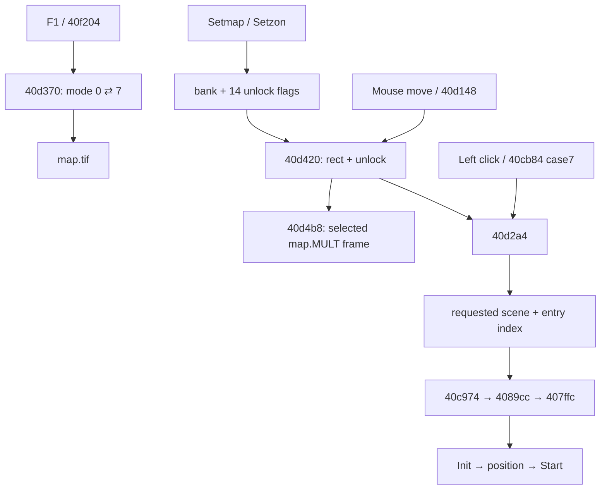

# Карта оригинального Agent.exe

## Результат и границы

**CONFIRMED (static):** карта — отдельный UI-режим EXE, не SCC-сцена, не
навигационная маска и не видеоролик. Открывается **F1**; SCC только выбирает
банк (`Setmap`) и открывает направления (`Setzon`). Для обычных выходов из
Level34 карта **не требуется**: см. [BLOCKER](../progression/BLOCKER.md).

Исследован master `fc07ae4`, оригинальный Agent.exe SHA-256
`71065c571a9cd40f460458d766720c0a01954e0bef521aad675b4ea6b3186e85`,
REA/Ghidra 12.1.4. Windows-процесс не запускался. CONFIRMED означает прочитанные
оригинальные инструкции/ресурсы либо явно обозначенное наблюдение Chromium;
DERIVED — следствие control flow; HYPOTHESIS — недоказанный кандидат.

## Ресурсы и геометрия — CONFIRMED

- Фон: `TZU\Interface\Map\map.tif` (в распакованном block0 — `Map.TIF`).
- Подсветка: `XSH\Interface\map.mult`, 7 кадров, по одному bitmap `Interface`
  в каждом. Это **MULT интерфейса**, не AVI и не сцена с героем.
- Фиксированные экранные позиции: EXE `0x44576c`, семь пар int32.
- Изображения и маска клика не совпадают по семантике: native hit-test использует
  **строгие прямоугольники**, не непрозрачные пиксели подсветки, не TIF mask.
- Координаты — логический экран 800×600, без scroll активной сцены.

| zone / frame | x,y (левый верхний угол) | размер | bank0 scene@portal | bank1 scene@portal |
|---|---|---|---|---|
| 0 / 1 | 208,59 | 100×138 | 47@0 | 16@0 |
| 1 / 2 | 417,315 | 130×122 | 45@0 | 20@0 |
| 2 / 3 | 424,48 | 242×97 | 39@0 | 5@0 |
| 3 / 4 | 269,153 | 230×143 | 1@0 | 37@0 |
| 4 / 5 | 0,157 | 205×177 | 41@0 | 10@0 |
| 5 / 6 | 570,216 | 230×167 | 46@0 | 29@0 |
| 6 / 7 | 128,384 | 215×216 | 44@0 | 18@0 |

Таблица переходов: `0x4456b4`, 2×7 пар `(scene,portal)`, шаг банка `0x38`,
направления 8 байт. Имена географических мест по этим числам не выдумываются.
Ни Level34, ни Level48 не являются назначениями этой карты.

## Доступность и состояние — CONFIRMED

`Setmap n`: parser `0x407846` → opcode `0x20` → executor `0x40659b`
пишет int `UI+0x21`. Не открывает карту и ничего не сбрасывает.

`Setzon z`: parser `0x407873` → opcode `0x21` → executor `0x4065a9`
→ `0x40d280`: `unlocked[bank*7+z]=1` в `0x445724` (14 int32).
Это **не** «текущая зона героя». Новая игра `0x40c6e4 → 0x40d1ec`:
bank=0, все флаги=0. Смена сцены их не обнуляет. Единственный `Setmap 1`
в корпусе — Level3:215, Init/Interface Case0. Перечень всех 15 `Setzon`
с контекстом хранится в source-facts; открытие направлений задаёт SCC, а не
автоматическое посещение сцены.

Save `0x40d220`: 4 байта bank + 14×4 unlocked; load `0x40d250` обратно.
`0x40c7c4` восстанавливает их до scene load/Start. Hover (`UI+0x15`), открытая
карта и выделение не входят в эти 60 байт. Отрицательные/невалидные индексы
не имеют безопасного native контракта — EXE не проверяет все границы.

## Ввод, рендер и переход — CONFIRMED static / DERIVED visible result

1. WndProc `0x40f204`, `WM_KEYDOWN`, wParam=`0x70` (F1), при отсутствии clip
   вызывает `0x40d370`. Во время clip эта клавиша **пропускает видео**.
2. `0x40d370`: только game mode0 → map mode7; отказывает при
   `Scene+0x709` busy или `Scene+0x73b` Block. Загружает фон через `0x40d508`,
   пересчитывает hover по последним mouse x/y. В других режимах, кроме 7, no-op.
3. Mouse move: `0x40f204 → 0x40d148 → 0x40d420`. Перебирает зоны 0..6;
   принимает `x0<x<x0+w`, `y0<y<y0+h` и unlocked!=0; иначе selected=-1.
4. Map update `0x40c974 case7 → 0x40d4b8`: фон через `0x40c4a4`, только
   выделенный кадр `selected+1` через `0x40c400`, затем UI-курсор
   `0x40d590` (`arrown.mult`, 12 кадров). Не выполняет scene tick.
5. Left down: `0x40f204 → 0x40cb84 case7 → 0x40d2a4`. Использует уже
   выбранный hover, не делает независимый поиск координат в click handler.
   При selected>=0 и bank>=0 читает target, пишет requested scene
   `DAT_0046851c`, играет UI WAV (`UI+0x265 → 0x402fc8`), пишет entry
   `targetScene+0x712` через `0x4096f4`, возвращает mode0 и освобождает фон.
6. Следующий обычный UI update `0x40c974 case0` обновляет старую сцену и
   обрабатывает отложенный requested scene: unload `0x4089cc`, load `0x407ffc`.
   Парсинг/ресурсы → Init первого посещения → entry positioning `0x40868c`
   → Start → initialized. **Особого SCC события Map/MapExit нет** в этой цепи.

Закрыть без перехода можно **F1** (mode7 → 0) или **Esc**
(`0x40cd6c case7 → 0x40d370`): фон освобождается, selected=-1.
Левый клик вне unlocked региона не закрывает карту; правый клик в mode7
отфильтрован `0x40cb84`. Открытие/закрытие не вызывает остановку музыки в
`0x40d370`; выбор вызывает UI effect. Реальное смешивание текущих голосов при
открытой карте требует Windows-run; не заявляется музыкальная пауза по аналогии
с главным меню.



## Сопоставление с портом

На `fc07ae4` `SceneLoader.setMapBank/unlockMapZone` и banked-v1 save уже
существуют. **Отсутствует UI-потребитель**: F1, фон, hover, выбор, переход и
закрытие. `src/main.ts` обрабатывает F2/F3, но не F1. Нельзя заменять банк
`zone`-интегером или добавлять автоматический unlock при каждом переходе.
Контракт реализации: [LUNA_SPEC](LUNA_SPEC.md).

## Воспроизводимость и evidence

Из worktree:

```sh
python3 research/progression/probe-original.py --output research/progression/evidence/source-facts.json
```

Probe читает оригинальные PE sections, SCC include closure и MULT через уже
имеющийся read-only decoder; выводит raw table/positions и размеры кадров.
Основные snapshots: [EXE UI/hit/executor](../progression/evidence/exe-first.json),
[map save/open](../progression/evidence/exe-second.json),
[WndProc/game loop](../progression/evidence/exe-third.json),
[hover/render/loader](../progression/evidence/exe-fourth.json),
[UI cursor](../progression/evidence/exe-fifth.json),
[entry/load](../progression/evidence/exe-sixth.json),
[raw tables](../progression/evidence/exe-mapbytes.json),
[open assembly](../progression/evidence/map-open-assembly.json),
[source facts](../progression/evidence/source-facts.json).
Адреса в batch-запросах могут быть interior; использовать canonical
`procedure.address` каждого item (например запрос 40cc04 разрешён в 40cb84).
