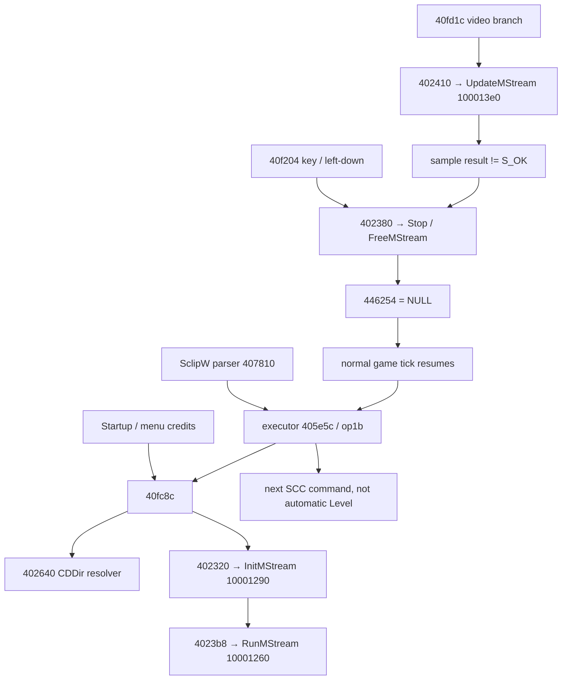

# Видео: Agent.exe ↔ zvideo.dll ↔ AVI

## Кратко

**CONFIRMED static:** `zvideo.dll` — адаптер Microsoft multimedia COM/DirectShow
для видео **и музыки**, не MULT decoder и не собственный видеокодек.
Видеофайлы — обычные RIFF AVI. `SclipW` — глобальный playback barrier:
возобновление SCC после освобождения clip pointer, не после первого кадра.
Обычный игровой tick не выполняется во время существования clip.

Исследованы оригинальные Agent.exe SHA-256
`71065c571a9cd40f460458d766720c0a01954e0bef521aad675b4ea6b3186e85`
и zvideo.dll SHA-256
`d6c1ae4457ef17357ff5da36391ac39567aee861d6ea44483df8b711c656f3b6`.
REA/Ghidra 12.1.4. Windows-процесс **не запускался**. Ниже CONFIRMED static
отделено от ffmpeg offline и Chromium reconstruction. DERIVED — следствие
проверенного control flow; UNKNOWN — не установленное поведение.

## Ресурсы — CONFIRMED offline

Физически: `agent-original/extracted/Data/*.avi`, вне RSS/MULT.
Все 400×300; Rolik2 — 10 fps, остальные — 15 fps; header `RIFF <size> AVI `, стандартные AVI stream headers.
Точные header bytes, stream metadata, duration, hashes:
[media-probe.json](evidence/media-probe.json).

| Файл | Видео FourCC / ffmpeg decoder | Аудио | Длительность, s |
|---|---|---|---|
| Title.avi | CRAM / msvideo1 | MS ADPCM, 22050 Hz | 35.6 |
| Titres.avi | BI_RLE8 / msrle | MS ADPCM, 22050 Hz | 46.067 |
| Rolik1.avi | IV50 / indeo5 | MS ADPCM, 22050 Hz | 156.067 |
| Rolik2.avi | IV50 / indeo5 | MS ADPCM, 22050 Hz | 59.4 |
| Rolik5.avi | IV50 / indeo5 | PCM s16le, 44100 Hz | 39.4 |
| Final.avi | IV50 / indeo5 | MS ADPCM, 22050 Hz | 103.867 |

Все 6 полностью декодированы ffmpeg в null output (видео **и** аудио).
Rolik2 целиком перекодирован в disposable H.264/yuv420p + AAC MP4/faststart,
затем MP4 полностью декодирован обратно без ошибок; временный MP4 удалён.
Это доказывает возможность offline-подготовки, **не** браузерную совместимость
конкретного build/codec и не A/V parity Windows. Оригинальные файлы не менялись.

`0x402640` резолвит filename через `HKLM\Software\Buka\Agent`, `CDDir%d`:
собирает `%s\%s`, пробует `rb`, ищет следующий путь. Отсутствие следующего
registry value → failure. Не искать AVI через WAV voice/RSS cache. В браузере
это следует заменить явным manifest соответствия original name→prepared URL.

## Все известные точки запуска

| Источник | Условие / SCC | После clip |
|---|---|---|
| Startup `0x40fd1c` | `0x40fda8` → Title.avi | обычный message loop, без SCC callback |
| Menu `0x40e200 case4` | Titres.avi | возврат к UI loop |
| Level1:141 | Init Interface Case0, SclipW0 Rolik1.avi | State Stat_v1, State Slip1 и дальнейший Program |
| Level34:215 | Click0 Knopka Per_plat Case1, SclipW0 Rolik2.avi | Knopka2, K_vniz, Per_plat2, cross-scene Lstate |
| Level25:318 | Click0 Laz_an Bomsh Case4, SclipW0 Rolik5.avi | Bomsh5, Lstate и **Level19 3** |
| Level28:182/202 | Door_a/Door Case3, SclipW0 Final.avi | **Egame**, не автоматический Level |

Полный SCC корпус и контексты: [source facts](../progression/evidence/source-facts.json).
На Level34 видео не переводит в Level48,35 или8: следующий код изменяет
состояния и остаётся в Level34. Название Active `To_48` не доказывает переход.

## Parser → EXE → DLL — CONFIRMED static

Parser `0x407810–0x40783e`: читает `%d %s`, создаёт opcode `0x1b`,
первый int хранится, но executor при запуске его **не использует**.
`SclipW 0 name.avi` не означает loop/fullscreen flag по первому аргументу.

`0x405e5c case0x1b`:

```text
if global 0x444690 == 0:
    0x40fc8c(filename)
    Program.pc = current
    global 0x444690 = 1
    return/yield
if global clip 0x446254 != NULL: return/yield
global 0x444690 = 0
advance to next command
```

В `0x40fc8c` resolver → allocate wrapper(7 bytes) →
`0x402320(wrapper,resolvedPath,DAT_00468768,0)` → `0x4023b8/_RunMStream`.
Обязательные параметры восстановлены по assembly: Ghidra decompiler теряет
часть cdecl arguments. Это важно: псевдокод с `_InitMStream()` **не** доказывает
отсутствия filename/DirectDraw arguments.

DLL `_InitMStream` `0x10001290`:

- CoInitialize; CoCreateInstance CLSID `49c47ce5-9ba4-11d0-8212-00c04fc32c45`
  / IID `bebe595c-9a6f-11d0-8fde-00c04fd9189d` (AMMultiMediaStream).
- Configure stream / DirectDraw, AddMediaStream primary video
  (`0x1000131d–0x1000132b`) и primary audio с flag1/default renderer
  (`0x10001330–0x1000133e`).
- ANSI filename→wide, OpenFile (`0x10001341–0x1000136b`), video sample/surface.
- `_RunMStream` `0x10001260`: stream SetState1; `_StopMStream` `0x10001250`:
  SetState0; `_SeekMStream` `0x10001270`: seek.

Main loop `0x40fd1c`, `0x40fdb3–0x40fdee`:
`0x402410(clip,DAT_00468770,rect,loop=0)` → DLL `_UpdateMStream 0x100013e0`.
rect из EXE `0x446338` = **(0,0,800,600)**. DLL получает sample surface
и blit на переданную DirectDraw surface; `0x1000141a` — vtable+0x14,
повторяет при `0x8876021c` (surface drawing still busy). Это полноэкранная
игровая поверхность, **не отдельное video window**, с масштабированием исходных
400×300 на 800×600 (DERIVED из source size + rect + blit arguments).

## Завершение, пропуск и ошибка — CONFIRMED static

`_UpdateMStream` возвращает 1 **только** если sample Update через vtable+0x18
вернул S_OK0 (`0x100013f9–0x10001402`). Не return результата Blt.
EXE при нуле: `0x402380(clip,3)` → stop/free → clip=NULL;
`DAT_00446260=1`. **EOF и sample error на этой границе не различаются.**
Не найдено отдельных SCC OnVideoEnd/OnVideoError или ожидания WAV EOF.

WndProc `0x40f204`: любое WM_KEYDOWN и WM_LBUTTONDOWN при clip!=NULL
также destructor→NULL→redraw flag; соответствующая клавиша/клик не идёт
в обычное действие (F1 не открывает карту, F2/F3 не save/load). Right down
имеет иной UI-путь; skip по правой кнопке не установлен. Не добавлять его
как «оригинальную» семантику.

Во время clip main loop не вызывает `0x40f484` game tick
(`0x40fe4d–0x40fe55`). После освобождения обычный tick возобновляет активный
Program и исполняет хвост после SclipW. Это **не callback decoder→SCC**.
StartW busy и video gate — разные поля. Loader, синхронно выполняющий Init,
всё ещё завершает positioning/Start до возврата в message loop. Поэтому
Init/Start могут сосуществовать, хотя дальнейшие игровые ticks остановлены.

Resolver failure (clip не создан): executor всё равно делает первый yield,
следующий poll видит NULL и продолжает. **UNKNOWN:** полная реакция на COM,
codec, allocation или partially initialized graph errors — DLL содержит
непроверенные indirect dereferences, нельзя объявлять всё безопасным no-op.
**UNKNOWN:** искусственная конкуренция двух SclipW; flags общие, не очередь.

## Аудио и Save/Load

**CONFIRMED static:** embedded audio — primary stream/default renderer DLL,
не SCC Fram/Voice. Музыка в той же DLL, но другой graph/globals:
`_InitMusic 0x10001000`, `_PlayMusic 0x100010d0`, `_GetMusicState 0x10001130`,
`_FreeMusic 0x10001200`; engine `Smusic →0x402768→0x4027bc→0x40282c`.
`0x40fc8c` не останавливает все WAV/MP3. Автоматическую pause/duck всего
аудио не считать восстановленной. См. [AUDIO_RUNTIME](../audio/AUDIO_RUNTIME.md).

**CONFIRMED static:** UI save/load hotkeys во время clip сначала skip;
состояние decoder/clip position/Program.pc отсутствует в scene serializers
`0x407d44/0x407e14` и map serializer. Load `0x40c7c4` восстанавливает
постоянные объекты, затем `0x407ffc(...,0)` / Start; не возобновляет видеокадр.
Безопасная browser policy — запретить save во время clip и незавершённого
SCC Program, не сериализовать HTMLMediaElement. Это **контракт порта**, не
заявление о поведении любого внешнего способа записи native save mid-clip.

## Call graph



## Evidence и воспроизводимость

- [executor](../progression/evidence/exe-first.json),
  [wrapper/resolver](../progression/evidence/exe-second.json),
  [WndProc/loop](../progression/evidence/exe-third.json),
  [free/loader](../progression/evidence/exe-fourth.json).
- [video entry assembly](evidence/videoentryasm.json),
  [video update assembly](evidence/videoupdateasm.json),
  [DLL pseudocode](evidence/dll.json),
  [DLL init assembly](evidence/dllinitasm.json),
  [DLL update assembly](evidence/dllupdateasm.json),
  [DLL stop/run/seek/music](../progression/evidence/exe-dllmisc.json).
- [save serializers](../progression/evidence/exe-savevideo.json),
  [menu/entry](../progression/evidence/exe-sixth.json).
- `E2E_OUTPUT_DIR=research/video/evidence node research/video/probe-media.mjs`
  полностью повторяет offline decode/transcode. Требуется ffmpeg с libx264/AAC.
  TestResources завершает owned children и удаляет disposable conversion dir.

Настоящие visual timing, A/V sync, пропуск при разных Windows codecs,
смешивание звука и ошибочные COM-пути требуют реального Windows-run.
Контракт Luna: [LUNA_SPEC](LUNA_SPEC.md).
